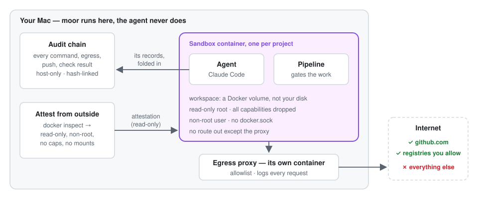

# moor

Run an AI coding agent on your Mac without giving it your Mac.

moor puts each project in its own locked-down Docker container and runs the
agent there (Claude Code today; Copilot and Kiro are supported too). The agent
can't see your files, can only reach the internet through an allowlist, and
can't approve its own work. moor stays outside, keeps a tamper-evident record
of what happened, and tells you what to do next.

<p align="center"></p>

## Why you might want it

Agents run commands, install packages and clone repos you haven't read. If
one is tricked or just wrong, you'd rather it break a throwaway container than
your laptop. And when it's done, you'd like to know what it did.

- **Contain it.** A bad run can damage one disposable container, not your Mac
  or your other projects.
- **Limit what leaks.** Traffic leaves only through a proxy that allows what
  you list (GitHub, your package registries) and logs everything, blocked
  requests included.
- **See what happened.** Commands, connections, pushes and approvals go into a
  hash-chained log on your Mac. `moor audit --verify` tells you if anyone
  edited it.
- **Stay in charge.** Work moves through checkpoints the agent can run checks
  for, but only you can approve.

Good for: trying an agent on code or a repo you don't fully trust, letting it
work unattended while you do something else, and being able to show a
teammate exactly what a change involved.

## How it works

1. `moor new` makes a sandbox container for the project, plus a second
   container that is its only route to the internet.
2. The agent works inside the sandbox. Your code lives in a Docker volume, not
   a folder on your Mac, and the container is read-only, non-root, with no
   Docker socket.
3. A change moves through seven steps: write a spec, check it, approve it,
   plan, check the plan, approve it, build. The checks and the pipeline come
   from [keel](https://github.com/daneb/keel), which moor installs inside each
   sandbox and drives for you.
4. `moor next` always tells you where you are and the one command to run.

You never need keel on your Mac. Everything below is a `moor` command.

## Install

You need macOS, [Docker or OrbStack](https://orbstack.dev), and an Anthropic
API key or Claude subscription.

```bash
brew install --cask daneb/tap/moor
./images/build.sh        # once; the cask prints where its sources are
```

To build from source instead: `cd cli && cargo build --release`.

## Try it

```bash
moor new my-app --image moor/node:latest   # or: moor import my-app --from ~/Repos/my-app
moor secrets set my-app ANTHROPIC_API_KEY  # kept in your macOS Keychain

moor ask "why is the login test flaky?"    # just talk to the agent

moor spec new login                        # writes login.spec.md for you to fill in
moor spec push login.spec.md               # sends it in and checks it
moor next                                  # my-app · login · step 5 of 7: approve the plan
moor approve                               # shows you the plan, asks y/N
moor go                                    # runs steps until one needs you
moor ship                                  # commits on a branch, pushes, opens a PR
```

If you forget everything else, run `moor next`.

Prefer a page to a terminal? `moor ui` opens a console in your browser
(local only). More: `moor audit`, `moor bundle` (package a run's evidence),
`moor selftest` (re-check the lockdown), `moor shell`, `moor recipe`.
`moor --help` lists them all.

## What it isn't

- **macOS only** for now, built around Docker/OrbStack.
- **Not a VM.** Containers share your Docker host's kernel, so a kernel-level
  escape isn't defended against ([why](docs/decisions/0001-container-runtime-choice.md)).
- **Not a way to make the agent correct.** It limits the damage and shows
  you what happened.
- **Not independently audited.** The security claims are backed by tests and
  `moor selftest`, but that's self-assessed. Known gaps:
  [docs/SECURITY-NOTES.md](docs/SECURITY-NOTES.md).

## A note on the name "keel"

Working on moor itself, or pointing an AI assistant at this repo? "keel" can
mean the upstream project, the copy inside each sandbox, the MCP server that
lets the agent run checks, or an optional copy on your Mac used only for this
repo's own development. As a user, you only ever type `moor`. The details are
in [CLAUDE.md](CLAUDE.md) and [docs/ARCHITECTURE.md](docs/ARCHITECTURE.md).

## Learn more

- [Walkthrough](docs/WALKTHROUGH.md): a real idea-to-PR run, bugs included
- [Architecture](docs/ARCHITECTURE.md) · [threat model](docs/THREAT-MODEL.md)
- [Adopting an existing project](docs/MIGRATING.md) · [recipes](docs/RECIPES.md)
- [Images](docs/IMAGES.md) · [agent transport](docs/MCP.md) · [CI](docs/CI.md)
- [Design decisions](docs/decisions/) · [security notes](docs/SECURITY-NOTES.md)
- [Contributing](CONTRIBUTING.md) · [history](docs/HISTORY.md) · [changelog](CHANGELOG.md)

MIT licensed.
